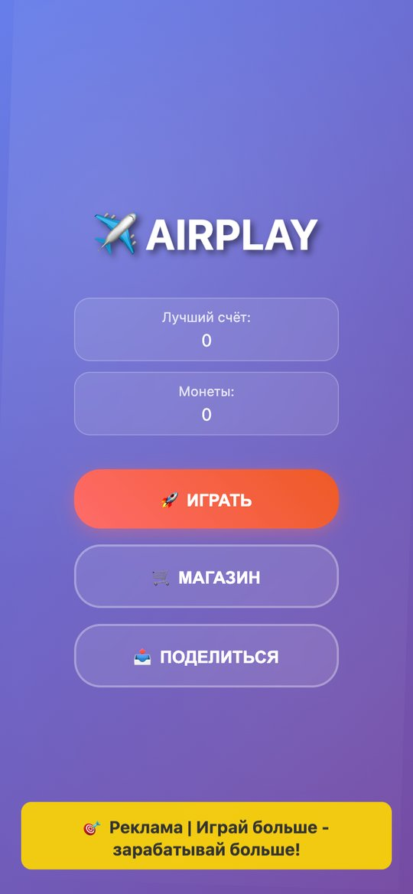
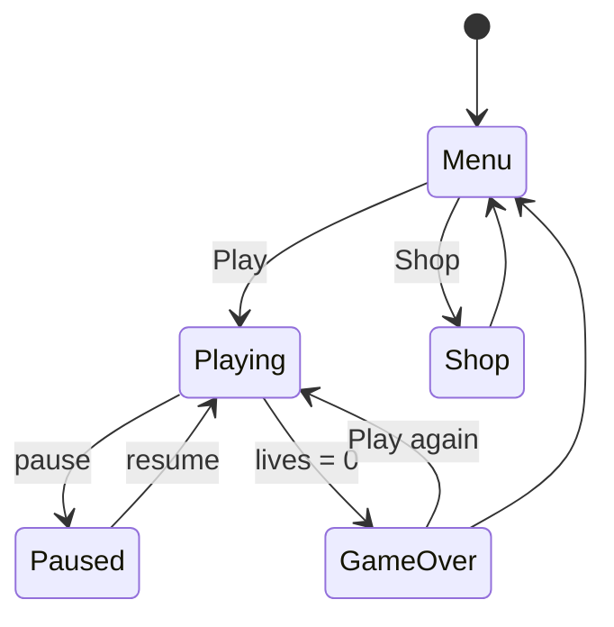

# Airplay — arcade plane game for Telegram

A casual arcade game that runs as a **Telegram Mini App / PWA**: fly a plane, dodge obstacles, collect coins, unlock new planes and power-ups in the shop and share your score with friends. Includes a 2D canvas version and an experimental 3D mode.

<p align="center"></p>

## Game loop



## Features

- Endless arcade gameplay with score, best score and three lives
- Coins collected during flights, spent in the shop on new planes and power-ups
- Menu, pause, game-over and shop screens
- Share button and a promo banner slot
- Fullscreen portrait PWA manifest for Telegram

## Files

```
index.html     — entry point and UI screens
game.js        — 2D canvas game: state machine, physics, obstacles, coins, shop
game3d.js      — experimental 3D mode
styles.css     — UI styles
manifest.json  — PWA manifest
```

## Run locally

```bash
python3 -m http.server 8000
# open http://localhost:8000 in a mobile viewport
```

## Docs

- [`BOTFATHER_SETUP.md`](BOTFATHER_SETUP.md) — registering the game with @BotFather
- [`MINI_APPS_INTEGRATION.md`](MINI_APPS_INTEGRATION.md) — Telegram Mini Apps integration
- [`DEPLOYMENT_GUIDE.md`](DEPLOYMENT_GUIDE.md), [`TESTING_GUIDE.md`](TESTING_GUIDE.md)
- [`IMPROVEMENTS_AND_MONETIZATION.md`](IMPROVEMENTS_AND_MONETIZATION.md) — roadmap and monetisation ideas
